# Data Creation Box
2025 (This semester) • *An automated rig that creates varied, label-ready image datasets, so industrial vision systems can learn from data instead of hand-tuned rules.*

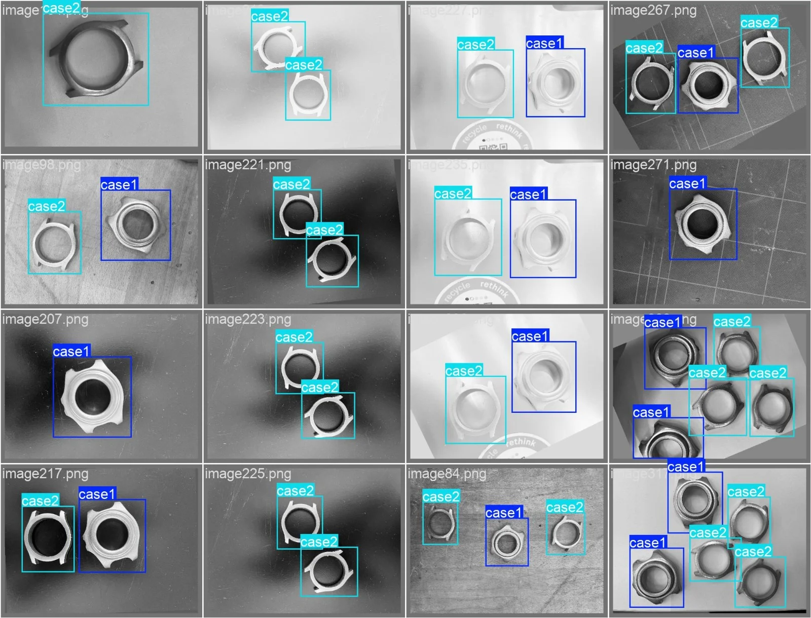

  
<strong>Award.</strong> Our team won the competition for the best startup project in the MGT-555 course.

  
MGT-555 (Innovation &amp; Entrepreneurship in Engineering) is a course by the EPFL School of Engineering and the College of Management.

---

## The Problem

Machine vision is widely used in watchmaking, medical devices, and micro-mechanics, but most systems still run on rule-based pipelines. They are brittle: a small change in lighting, reflections, or part position can break them, and every new part means an expert has to redesign the inspection logic. An industrial partner reported about **95% reliability** for such systems, which is not enough for continuous production, where a 5% failure rate keeps interrupting the line.

Machine learning could remove that re-engineering, but only with enough representative data. Today that means engineers **traveling on site** to photograph parts under every lighting condition and angle. It is slow, it ties up scarce specialists, and the trips carry a carbon footprint of their own.

Our question: *how can we create representative, label-ready datasets in a standardized way, with fewer on-site visits and less dependence on vision experts?*

---

## The Solution

The **Data Creation Box** is a compact, automated capture station. Instead of compensating for poor data with complex algorithms, it creates good data at the source: it turns the object, changes the light, and photographs it from several viewpoints, all from a single button.

<figure style="margin: 1.5rem 0;">
  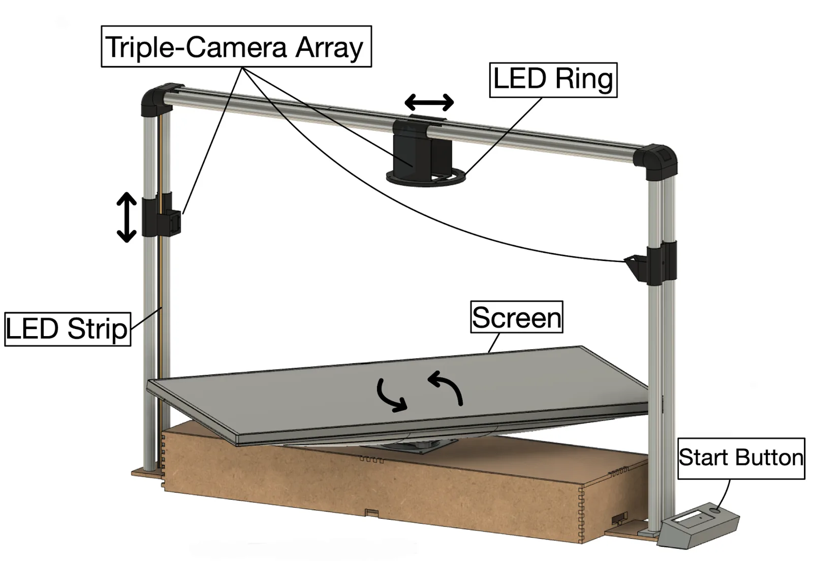
  <figcaption style="text-align: center; margin-top: 0.5rem;">CAD overview of the prototype: camera array, LED ring and strip, rotating screen, and start button.</figcaption>
</figure>

**What it is made of**

* A **Raspberry Pi 5** controls everything and runs the capture sequence.
* A **stepper motor** rotates a screen that holds the object and doubles as a programmable background, over a full 360 degrees.
* **Three cameras** of different types sit on a steel-bar frame and can be repositioned for different viewpoints.
* **Independently controllable lighting** (an LED strip, an LED ring, and a bulb) varies intensity and color and creates deliberate reflections.
* A **laser-cut MDF** base and enclosure that can isolate the setup from ambient light, with **3D-printed** camera mounts and control box.

  <figure style="margin: 0;">
    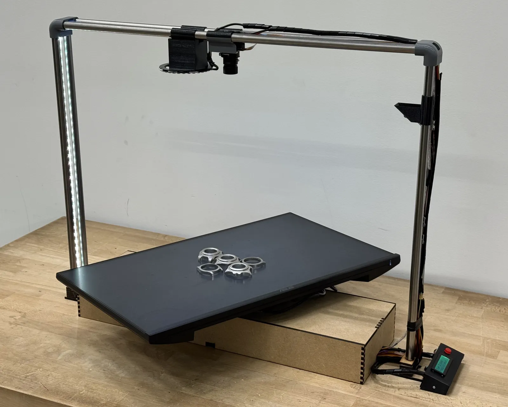
    <figcaption style="text-align: center; margin-top: 0.5rem;">The physical prototype with five watch cases on the tilted, rotating screen.</figcaption>
  </figure>
  <figure style="margin: 0;">
    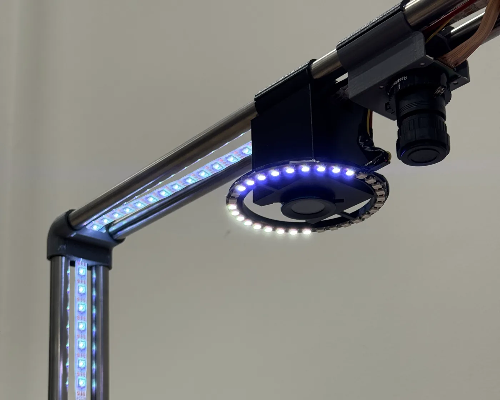
    <figcaption style="text-align: center; margin-top: 0.5rem;">The LED ring and strip next to the camera, used to vary the lighting.</figcaption>
  </figure>

---

## How a Capture Run Works

1. **Place and press.** The operator puts the parts inside the red guide circle on the screen and presses the start button.
2. **Rotate.** The screen turns by randomized increments of roughly ten degrees.
3. **Vary and capture.** At every step the lighting changes in intensity and color, the background changes, and all three cameras take a picture.
4. **Deliberate randomness.** The loop is fixed but its parameters are random, and nothing depends on image content, so runs are repeatable while still covering a wide range of conditions.
5. **Hand over.** The images are uploaded to cloud storage or downloaded through the web interface, and a small display on the control box shows the status (setup, capture, upload, or an error).

<figure style="margin: 1.5rem 0;">
  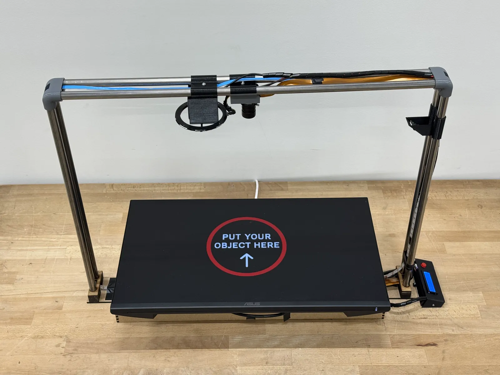
  <figcaption style="text-align: center; margin-top: 0.5rem;">The screen shows where to place the parts before a run starts.</figcaption>
</figure>

  <figure style="margin: 0;">
    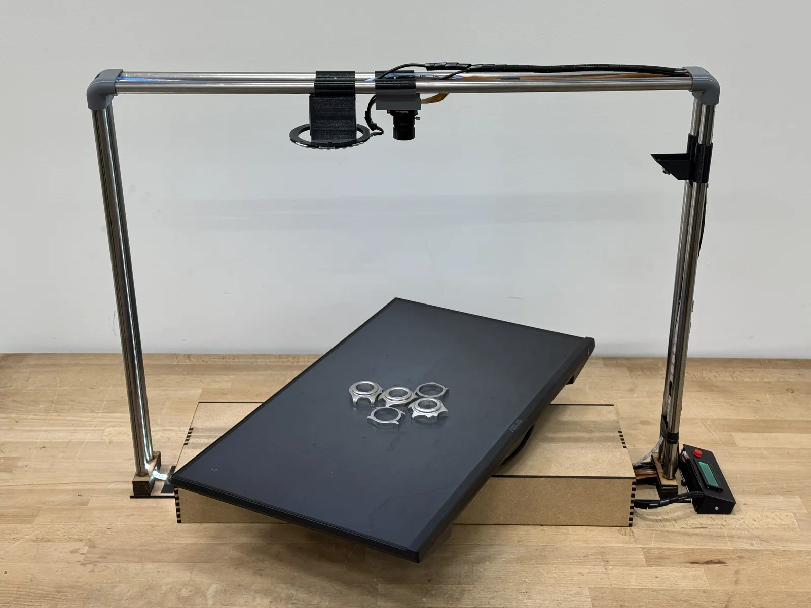
  </figure>
  <figure style="margin: 0;">
    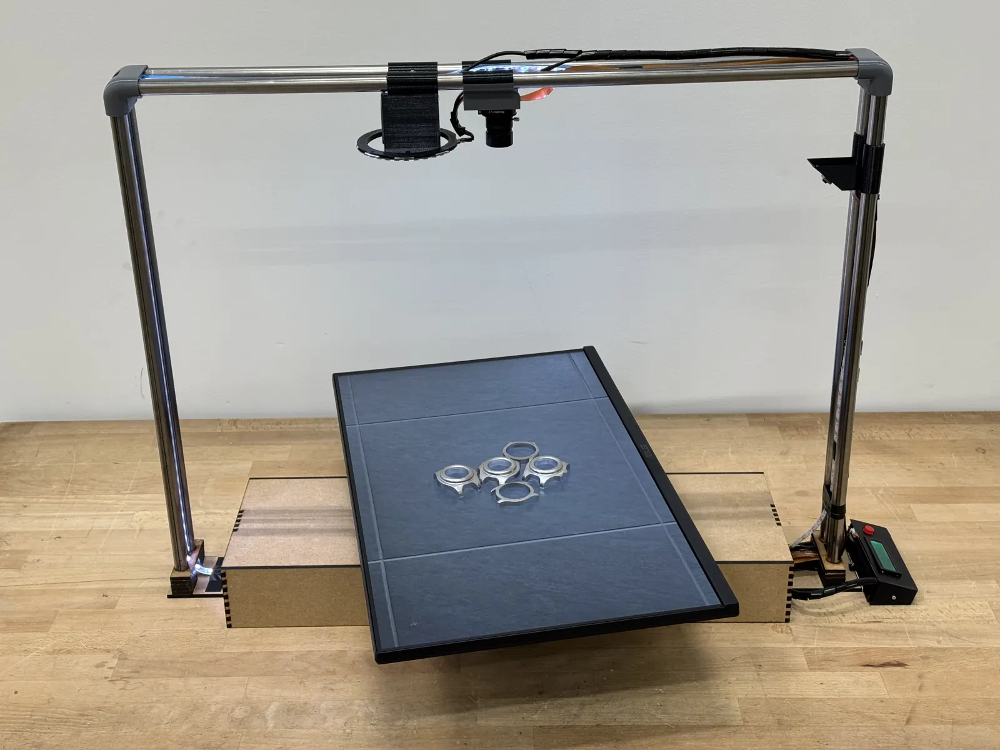
  </figure>
  <figure style="margin: 0;">
    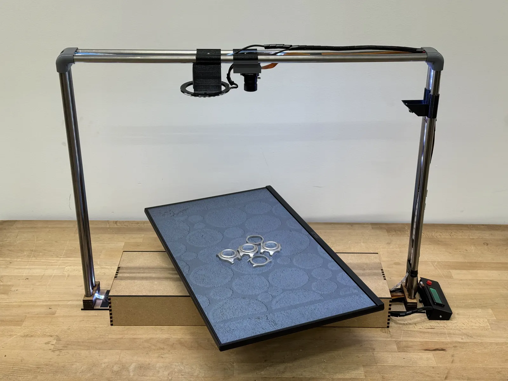
  </figure>
  <figure style="margin: 0;">
    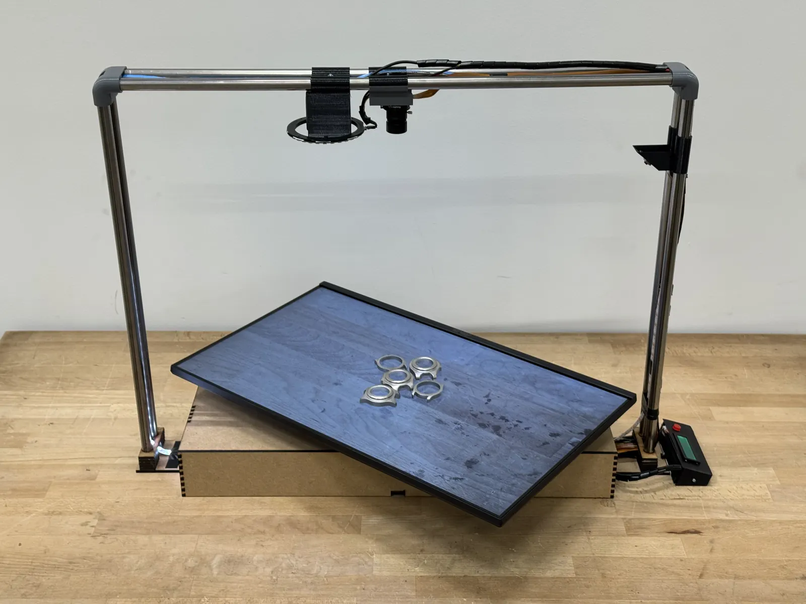
  </figure>

Four frames from one run: the platform turns the parts to new orientations while the on-screen background changes.

<figure style="margin: 1.5rem 0;">
  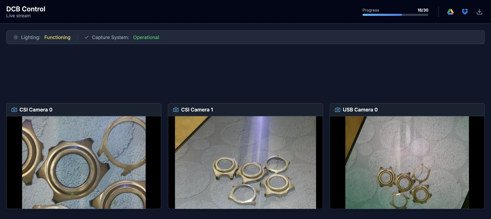
  <figcaption style="text-align: center; margin-top: 0.5rem;">The web interface streams the three cameras live and shows progress and system status during a run.</figcaption>
</figure>

---

## From Images to a Trained Detector

* **Labeling.** Images are annotated in **Label Studio** with oriented bounding boxes, one text file per image in YOLO format, so the dataset plugs straight into a standard training pipeline. In our test case there are two types of watch cases. Annotation is currently the slowest manual step.
* **Training.** After a train/validation split, we fine-tune pretrained **YOLO11n** (axis-aligned boxes) and **YOLO11n-OBB** (oriented boxes) models by transfer learning, so they learn to find each part and tell its type apart under varied light, background, and pose.
* **Inference.** Once a model is trained, new captures need no manual labeling: the model detects the parts automatically, and the web interface reports results per camera.

<figure style="margin: 1.5rem 0;">
  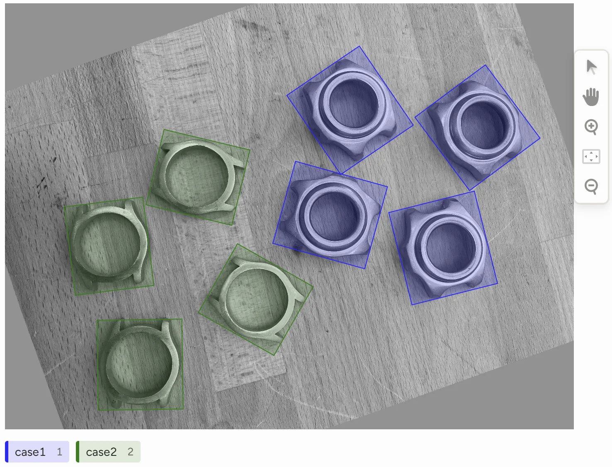
  <figcaption style="text-align: center; margin-top: 0.5rem;">Oriented bounding-box annotation of the two watch-case classes in Label Studio.</figcaption>
</figure>

---

## Results

* **Lightweight models trained only on box data.** Both YOLO11n and YOLO11n-OBB localize and classify the two watch-case types reliably on held-out validation images, with mAP50 close to 1.0.
* **Small test with a clean score.** On a small test set, the YOLO11n evaluation dashboard reported every part detected with no false positives for two of the three cameras. The third camera's partial, cut-off view is excluded from that score.
* **Faster integration (our estimate).** Capture and labeling take roughly one to a few hours in total, plus offline training, instead of anywhere from several hours to a week of vision engineering per new part.

<figure style="margin: 1.5rem 0;">
  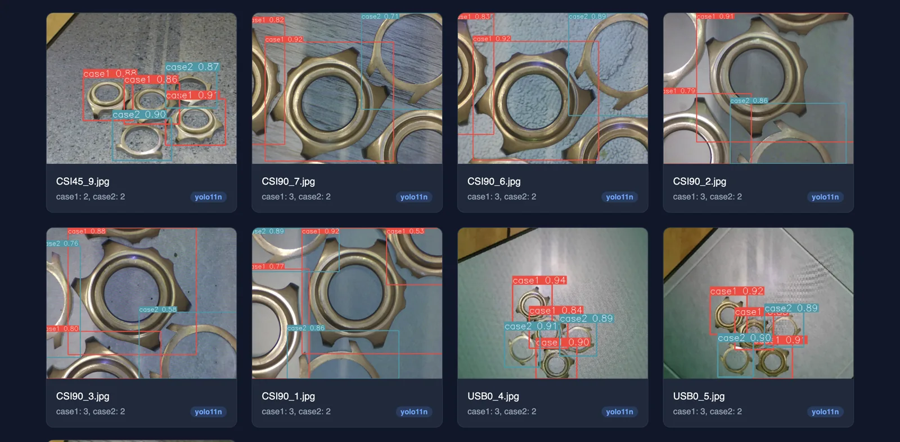
  <figcaption style="text-align: center; margin-top: 0.5rem;">Detections from the trained model on test images, shown in the evaluation interface.</figcaption>
</figure>

---

## Market and Business Model

* **Who needs it.** High-mix, low-volume precision manufacturing: watchmaking and micro-mechanics, medical devices, precision components, and vision-guided robot cells, where new parts arrive often and downtime is expensive.
* **What it offers.** Faster integration of new parts, less dependence on vision specialists, and more consistent training data. It complements existing robotics and vision software rather than competing with it.
* **How it earns.** A hybrid model: the box is sold as an industrial tool, with recurring revenue from a software subscription (updates, cloud connectivity, remote management) and optional access to pre-generated datasets for common parts.
* **Protection.** A defensive IP strategy covering the hardware layout, the control scripts and lighting sequences, and the software.
* **Stress test.** Base, pessimistic, and optimistic sales scenarios all stayed viable, even with sales at half of the target.

<figure style="margin: 1.5rem 0;">
  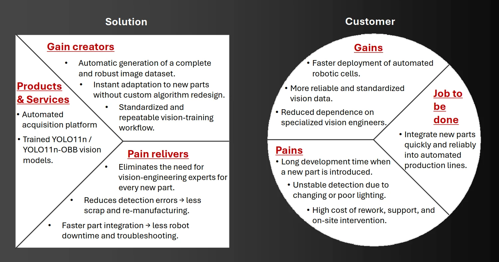
  <figcaption style="text-align: center; margin-top: 0.5rem;">Value proposition canvas: what the solution offers against what the customer needs.</figcaption>
</figure>

---

## Sustainability

* **A clear metric.** We compared concepts by the CO2e needed per integration task, since on-site travel and rework often outweigh the footprint of the deployed model itself.
* **Small device footprint.** A life-cycle assessment of the box shows a limited footprint dominated by the electronics. Operating energy is negligible, and the enclosure is minimal.
* **Large process saving.** By removing on-site data-collection trips, we estimate about **96.5% less CO2e per integration task**, with the device's embodied carbon spread over 200 jobs. It pays back its own manufacturing footprint after roughly seven to eight avoided trips.
* **Trade-off.** The main drawback is electronic waste at end of life, which we address with modular, easily separable components for repair and recycling.
* **Goals.** The work maps to UN Sustainable Development Goals 9 (Industry, Innovation and Infrastructure) and 12 (Responsible Consumption and Production).

---

## How We Worked

* **Design Thinking.** We followed the empathize, define, ideate, prototype, and test cycle, starting from interviews and observations.
* **Needs to specifications.** Six customer needs (representative variability, less expert dependence, short iteration cycles, low intrusiveness, compatibility with standard ML pipelines, and scalability and repeatability) were translated into design specifications.
* **Comparing alternatives.** We assessed rule-based vision, software-only augmentation, simulation-only synthetic data, manual on-site collection, and lab-grade capture rigs. A compact physical rig was the one that tackled the root cause, the data, while staying deployable and sustainable.
* **Fast iteration.** We built the prototype with off-the-shelf electronics, laser-cut MDF, and 3D-printed parts at EPFL SPOT, which kept it cheap and modular.
* **Team.** Six students covered the hardware, the capture software and ML pipeline, and the market and sustainability analysis.

---

## Long-Term Strategy and Next Steps

* **Phase 1, validate.** Secure the intellectual property around the acquisition method and run paid pilots with early adopters to check hardware reliability in real production conditions.
* **Phase 2, productize.** Launch a standardized product with a cloud platform, so teams can manage data-collection campaigns remotely across several sites.
* **Phase 3, ecosystem.** As the installed base grows, offer pre-trained models for common industrial parts, shifting value from the device to the data it produces.
* **Technical next steps.** Add segmentation-model-assisted "click-to-label" to remove manual box drawing, prove mechanical reliability over thousands of cycles, and make datasets compatible with proprietary vision software.
* **Open challenge.** Convincing vision engineers that physically generated data is a credible alternative to manual tuning.
