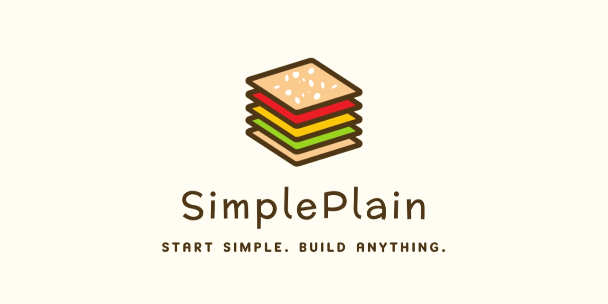

# Personal Website Built on SimplePlain
_Independent • 2025_

## Overview
Cloned the SimplePlain template and transformed it into a tailored personal site with data-driven sections, immersive project detail routes, and horizontal media rails for reports, videos, and galleries.

## Highlights
- Replaced GitHub auto-fetch with a curated CV-driven dataset for full control over messaging.
- Implemented inline PDF and media viewers optimized for a 50% viewport height rail.
- Extended routing to support slugged project pages with related-project carousels and responsive layout tweaks.
